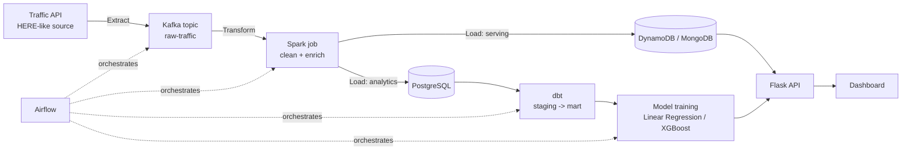

# Nghiên Cứu Và Xây Dựng Hệ Thống Xử Lý Dữ Liệu Lớn Phục Vụ Giám Sát Giao Thông Thời Gian Thực

> A big-data processing pipeline for real-time traffic monitoring — a Data
> Engineer internship project inspired by
> [TrafficPredictor](https://github.com/vinhky123/TrafficPredictor).
> Focus: production-style batch + streaming data engineering (Kafka, Spark,
> Airflow, dbt), not just a one-off script.

## Overview

This project ingests live traffic-flow data from a public traffic API,
processes it through a streaming + batch ETL pipeline, stores it in both a
low-latency serving store and an analytical warehouse, and serves speed
forecasts through a simple ML model and API.

It's built to demonstrate core Data Engineer skills end-to-end:
- Streaming ingestion (Kafka)
- Distributed data processing (Spark)
- Orchestration & scheduling (Airflow)
- Analytical modeling (dbt)
- Infrastructure as code (Terraform)
- Testing & CI (pytest, GitHub Actions)

## Architecture



| Stage | Component | Purpose |
|---|---|---|
| Extract | Python script / Lambda | Pull raw traffic records from the source API |
| Buffer | Kafka | Decouple extraction from processing, simulate real-time streaming |
| Transform | Spark (batch / structured streaming) | Clean, validate, compute derived metrics (speed, congestion ratio, jam factor) |
| Load (serving) | DynamoDB / MongoDB | Low-latency reads for the API/dashboard |
| Load (analytics) | PostgreSQL + dbt | Historical data for analysis and model training |
| Orchestration | Airflow | Schedules and monitors every stage above |
| Modeling | scikit-learn / XGBoost | Speed forecasting |
| Serving | Flask REST API | Exposes current speed + forecast per segment |
| Infra | Terraform | Provisions cloud resources |
| CI | GitHub Actions | Runs lint + pytest on every push |

## Tech Stack

- **Language:** Python 3.11+
- **Streaming:** Apache Kafka
- **Processing:** Apache Spark
- **Orchestration:** Apache Airflow
- **Storage:** DynamoDB / MongoDB (serving), PostgreSQL (analytics)
- **Transformation (warehouse):** dbt
- **Modeling:** scikit-learn / XGBoost
- **API:** Flask
- **Infra:** Docker, Terraform
- **Testing/CI:** pytest, GitHub Actions

## Project Structure

```
traffic-de-project/
├── transform/
│   ├── __init__.py
│   └── transform.py        # Core Transform-step functions (pure, unit-tested)
├── tests/
│   ├── __init__.py
│   └── test_transform.py   # pytest unit tests for transform.py
├── docs/
│   └── architecture-notes.md
├── README.md
└── requirements.txt
```

*(This repo currently contains the Transform module and its test suite as a
starting slice; Extract/Kafka producer, Spark job wiring, Airflow DAGs, dbt
models, and Terraform modules are being built out per the project roadmap.)*

## Quick Start

```bash
git clone <this-repo>
cd traffic-de-project
pip install -r requirements.txt

# run the unit tests
pytest -v
```

## Running Tests

```bash
pytest -v                 # verbose test run
pytest --cov=transform    # with coverage report
```

All Transform-step logic (speed normalization, congestion ratio, jam factor,
record validation, batch deduplication) is covered by unit tests in
`tests/test_transform.py`.

## Why This Architecture

See [`docs/architecture-notes.md`](docs/architecture-notes.md) for the
reasoning behind each technology choice and the trade-offs considered.

## Status / Roadmap

- [x] Transform module + unit tests
- [ ] Kafka producer/consumer for Extract → Transform
- [ ] Spark job for batch/streaming transform
- [ ] DynamoDB/MongoDB + PostgreSQL Load step
- [ ] Airflow DAGs for orchestration
- [ ] dbt models (staging → mart)
- [ ] Forecasting model (Linear Regression / XGBoost) + Flask API
- [ ] Terraform infrastructure
- [ ] CI pipeline (GitHub Actions)

## Acknowledgments

Architecture inspired by [TrafficPredictor](https://github.com/vinhky123/TrafficPredictor)
by vinhky123. This project re-implements the idea with a Data-Engineer-focused
scope (Kafka + Spark + Airflow + dbt) rather than the original's
serverless/AWS + transformer-model approach.
